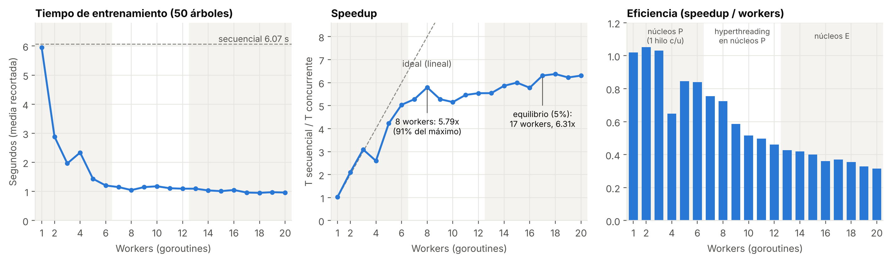
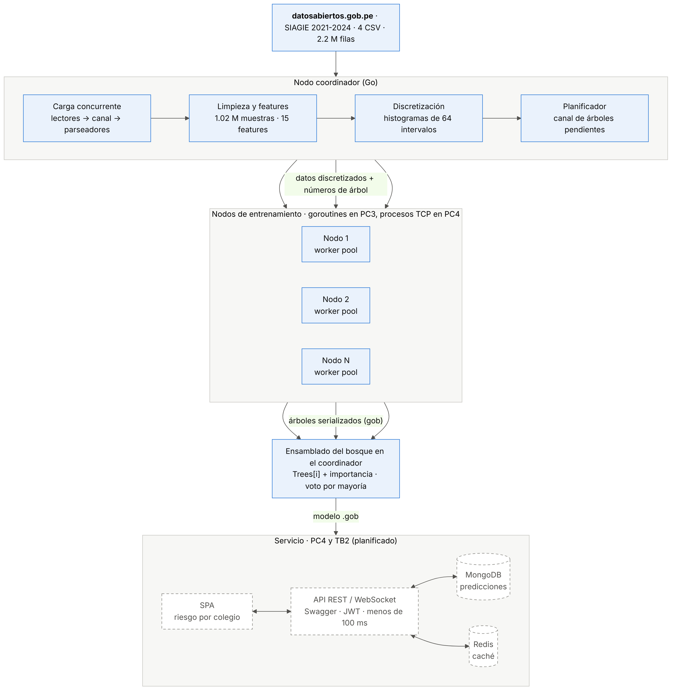
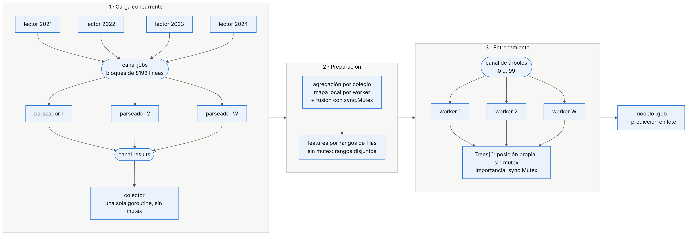

# EduForest

Random Forest concurrente y distribuido en Go para la **identificación temprana del riesgo de deserción y bajo logro escolar** en el Perú, con más de 2.2 millones de registros abiertos del MINEDU. Alineado con el **ODS 4 (Educación de Calidad)**.

Proyecto del curso **Programación Concurrente y Distribuida (CC65)**, UPC, ciclo 2026-2 · Grupo 02.

## Sobre el proyecto

El retiro escolar en secundaria pasó de 0.17% en 2021 a 1.40% en 2023, y en los colegios públicos de gestión directa duplica al de los privados. EduForest busca responder:

> ¿Es posible, usando solo datos abiertos del SIAGIE y un Random Forest entrenado de forma concurrente en Go, identificar con un año de anticipación los grupos de estudiantes y colegios con mayor riesgo de retiro escolar y bajo logro, para que las UGEL prioricen sus intervenciones?

El sistema carga y limpia los datos de forma concurrente y entrena dos clasificadores de tres clases (**nivel de logro** y **riesgo de deserción**). Mide además el speedup y la escalabilidad frente a una versión secuencial. Todo está escrito en Go con la librería estándar, sin dependencias externas.

## Resultados principales

| Métrica | Secuencial | Concurrente (20 workers) | Speedup |
|---|---|---|---|
| Carga de 2.2 M registros | 2.111 s | 0.340 s | **6.21x** |
| Entrenamiento de 100 árboles | 12.04 s | 1.55 s | **7.79x** |

| Modelo (evaluado en 2024) | Exactitud | Exactitud balanceada | F1 macro |
|---|---|---|---|
| Nivel de logro | 0.791 | 0.637 | 0.641 |
| Riesgo de deserción | 0.830 | 0.616 | 0.496 |

El modelo de riesgo identifica los grupos en riesgo alto **7.6 veces mejor que una revisión al azar**. El bosque es idéntico con cualquier número de workers, y lo verifican las pruebas automáticas.



El escalamiento es casi lineal hasta 6 workers (uno por núcleo de rendimiento). El punto de equilibrio está en 17 workers (6.31x), aunque con 8 ya se obtiene el 91% del speedup máximo.

## Arquitectura

La unidad de trabajo es el **árbol**: cada uno es independiente y tiene su propia semilla, así que se pueden construir en paralelo en varios núcleos (PC3) o en varios nodos conectados por TCP (PC4) sin cambiar el resultado.



El detalle del algoritmo, del protocolo distribuido y de los patrones de concurrencia está en [`docs/PC3/arquitectura.md`](docs/PC3/arquitectura.md).

### Concurrencia en Go

| Patrón | Dónde se usa |
|---|---|
| Pipeline con canales (lectores, parseadores, colector) | Carga de los 4 CSV |
| Worker pool con balanceo dinámico | Parseo de bloques y construcción de árboles |
| `sync.WaitGroup` | Cierre ordenado de canales y espera de workers |
| `sync.Mutex` | Agregación por colegio e importancia de variables |
| Semáforo (canal con buffer) | Discretización de variables en paralelo |
| Particionado sin bloqueo | Features, `Trees[i]` y predicción en lote |
| Reutilización de buffers por worker | Entrenamiento (−65% de memoria, −70% de ciclos de GC) |



## Dataset

**Matriculación y Trayectoria Estudiantil 2021-2024**, del Ministerio de Educación (Unidad de Estadística), publicado en la Plataforma Nacional de Datos Abiertos con licencia Open Data Commons Attribution.

- 4 archivos CSV (uno por año), 2,205,115 registros y 26 columnas.
- Cada registro es un grupo de estudiantes: colegio × nivel × edad × tipo de discapacidad.
- Tras la limpieza quedan **1,021,419 muestras** de primaria y secundaria, con 15 variables.

Enlace de descarga: https://www.datosabiertos.gob.pe/dataset/matriculaci%C3%B3n-y-trayectoria-estudiantil-2021-2024

Los CSV no están en el repositorio por su tamaño (unos 240 MB). Descárgalos y guárdalos en `data/siagie/` con estos nombres:

```
data/siagie/siagie_matricula_2021.csv
data/siagie/siagie_matricula_2022.csv
data/siagie/siagie_matricula_2023.csv
data/siagie/siagie_matricula_2024.csv
```

## Estructura del repositorio

```
go/
  cmd/loader/          carga concurrente vs secuencial, limpieza y exportación
  cmd/eduforest/       entrenamiento, evaluación, benchmark y barrido de workers
  internal/dataset/    lectura de CSV (pipeline), limpieza y variables
  internal/forest/     Random Forest: histogramas, bootstrap balanceado, worker pool
  internal/metrics/    matriz de confusión, recall, F1 macro, exactitud balanceada
  internal/bench/      media recortada, speedup, eficiencia y punto de equilibrio
notebooks/             análisis exploratorio (EDA)
scripts/               gráfico de escalabilidad
docs/PC3/              arquitectura, diagramas y figuras del informe
results/               métricas, bench y sweep de las corridas
```

## Cómo ejecutarlo

**Requisitos:** Go 1.26 o superior (ver `go/go.mod`). Para el notebook y el gráfico, Python 3 con pandas y matplotlib.

Desde la carpeta `go/`:

```bash
go test -race ./...                                                  # pruebas con detector de carreras
go run ./cmd/loader                                                  # carga secuencial vs concurrente y limpieza
go run ./cmd/eduforest -target riesgo                                # entrena y evalúa el modelo de riesgo
go run ./cmd/eduforest -target logro                                 # entrena y evalúa el modelo de logro
go run ./cmd/eduforest -target riesgo -mode bench -runs 5            # speedup del entrenamiento
go run ./cmd/eduforest -target riesgo -mode sweep -runs 5 -trees 50  # barrido de 1 a N workers
```

Los modelos se guardan en `models/` y los resultados de bench y sweep en `results/`.

Desde la raíz del repositorio:

```bash
python scripts/graficos_escalabilidad.py   # gráfico a partir de results/sweep_riesgo.csv
```

### Parámetros de `eduforest`

| Flag | Por defecto | Descripción |
|---|---|---|
| `-target` | `riesgo` | Variable objetivo: `riesgo` o `logro` |
| `-mode` | `train` | `train`, `bench` o `sweep` |
| `-workers` | núcleos lógicos | Goroutines para cargar, entrenar y predecir |
| `-trees` | 100 | Número de árboles |
| `-max-depth` | 14 | Profundidad máxima de cada árbol |
| `-balance` | 0.5 | Corrección del desbalance: 0 = ninguna, 1 = clases iguales |
| `-test-year` | 2024 | Año reservado para evaluar |
| `-runs` | 5 | Corridas por medición (bench y sweep) |

## Pruebas

15 pruebas automatizadas en los paquetes `dataset`, `forest`, `metrics` y `bench`, ejecutadas con el detector de carreras de Go. Entre otras cosas, comprueban que:

- La carga concurrente devuelve exactamente los mismos registros que la secuencial.
- El bosque entrenado con 1, 2, 3 u 8 workers es idéntico.
- Un modelo que siempre dice "riesgo bajo" tiene 94% de exactitud pero un F1 macro bajo, que es por qué se reportan métricas balanceadas.

## Análisis exploratorio

El notebook [`notebooks/eda_siagie.ipynb`](notebooks/eda_siagie.ipynb) revisa la calidad de los datos, unifica los esquemas que cambian entre años, analiza el retiro y la no aprobación por nivel y tipo de gestión, y justifica las clases objetivo. Sus resultados coinciden exactamente con la limpieza en Go.

## Flujo de trabajo

Usamos **Git Flow**: cada tarea se desarrolla en una rama `feature/...` que sale de `develop` y vuelve por Pull Request. `main` solo recibe las versiones entregadas.

Las tareas se siguen en el [tablero Kanban del proyecto](https://github.com/users/ShoterBroXD/projects/1/views/2).

## Hoja de ruta

- [x] **PC3:** carga concurrente, limpieza, Random Forest concurrente, pruebas y benchmarks
- [ ] **PC4:** clúster de nodos por TCP, API REST/WebSocket con Swagger y JWT, MongoDB y Redis, Docker Compose
- [ ] **TB2:** aplicación web (SPA) con el riesgo por colegio, informe final y video

## Integrantes

| Nombre | Código | GitHub |
|---|---|---|
| Diego Fernando Meléndez Marín | U202220345 | [@ShoterBroXD](https://github.com/ShoterBroXD) |
| Ángel Gabriel Díaz Chavez | U20221C424 | [@Nakamuros](https://github.com/Nakamuros) |
| Diego Tomás Villafuerte Ramírez | U202010546 | [@DTomasVr](https://github.com/DTomasVr) |
