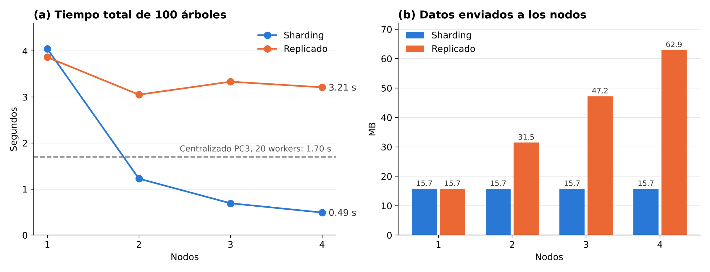
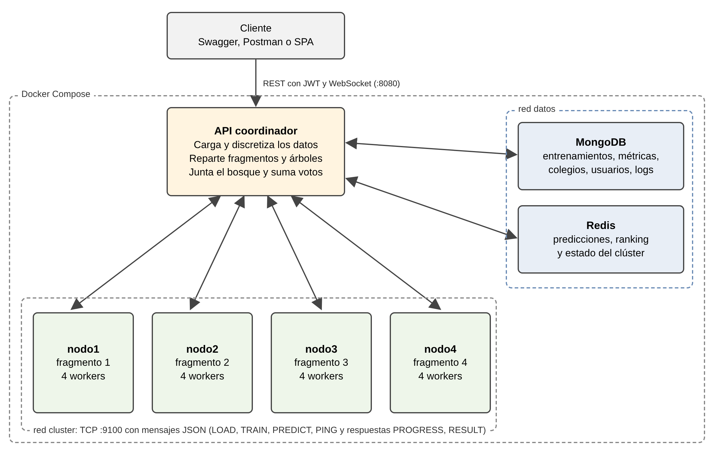

# EduForest

Random Forest concurrente y distribuido en Go para la **identificación temprana del riesgo de deserción y bajo logro escolar** en el Perú, con más de 2.2 millones de registros abiertos del MINEDU. Alineado con el **ODS 4 (Educación de Calidad)**.

Proyecto del curso **Programación Concurrente y Distribuida (CC65)**, UPC, ciclo 2026-2 · Grupo 02.

## Sobre el proyecto

El retiro escolar en secundaria pasó de 0.17% en 2021 a 1.40% en 2023, y en los colegios públicos de gestión directa duplica al de los privados. EduForest busca responder:

> ¿Es posible, usando solo datos abiertos del SIAGIE y un Random Forest entrenado de forma concurrente en Go, identificar con un año de anticipación los grupos de estudiantes y colegios con mayor riesgo de retiro escolar y bajo logro, para que las UGEL prioricen sus intervenciones?

El sistema carga y limpia los datos de forma concurrente y entrena dos clasificadores de tres clases (**nivel de logro** y **riesgo de deserción**) en un **clúster de nodos que se comunican por TCP**. Un coordinador expone una **API REST y WebSocket** con JWT y Swagger, guarda los resultados en **MongoDB**, usa **Redis** como caché y entrega el riesgo estimado de más de 48 mil colegios. Todo se levanta con **Docker Compose**.

## Resultados principales

**Entrenamiento distribuido (PC4):** 100 árboles, nodos de 4 núcleos cada uno.

| Modo | Nodos | Tiempo total | Speedup vs 1 nodo | F1 macro | Datos enviados |
|---|---|---|---|---|---|
| Centralizado (PC3, 20 workers) | 1 | 1.70 s | | 0.496 | |
| **Sharding** | 4 | **0.49 s** | **8.2x** | 0.500 | 15.7 MB |
| Replicado | 4 | 3.21 s | 1.2x | 0.496 | 62.9 MB |



- Con sharding, cada nodo entrena la cuarta parte de los árboles sobre la cuarta parte de las filas: es 3.5 veces más rápido que la versión de un solo proceso y la calidad casi no cambia.
- El modo replicado produce **exactamente el mismo bosque** que la versión secuencial, lo que verifica que distribuir no altera el modelo.
- Si un nodo se cae a mitad del entrenamiento, sus árboles se reasignan y el entrenamiento termina completo (1000 árboles: 34.8 s con la falla, 33.2 s sin ella).
- La API responde en menos de 100 ms: una predicción votada por los nodos tarda unos 9 ms y desde Redis unos 3 ms.

**Concurrencia en un solo proceso (PC3):**

| Métrica | Secuencial | Concurrente (20 workers) | Speedup |
|---|---|---|---|
| Carga de 2.2 M registros | 2.111 s | 0.340 s | **6.21x** |
| Entrenamiento de 100 árboles | 12.04 s | 1.55 s | **7.79x** |

| Modelo (evaluado en 2024) | Exactitud | Exactitud balanceada | F1 macro |
|---|---|---|---|
| Nivel de logro | 0.791 | 0.637 | 0.641 |
| Riesgo de deserción | 0.830 | 0.616 | 0.496 |

El modelo de riesgo identifica los grupos en riesgo alto **7.6 veces mejor que una revisión al azar**.

## Arquitectura



| Componente | Responsabilidad |
|---|---|
| **API coordinador** (`cmd/api`) | Carga y discretiza los datos, reparte fragmentos y árboles a los nodos (fan-out), junta el bosque (fan-in), suma los votos al predecir y atiende la API |
| **Nodos ML** (`cmd/node`) | Guardan su fragmento, construyen sus árboles con un worker pool y votan con ellos |
| **MongoDB** | Entrenamientos, métricas de los nodos, riesgo por colegio, usuarios y logs |
| **Redis** | Caché de predicciones, ranking de colegios precalculado y estado del clúster |

La topología es en **estrella**: los nodos solo hablan con el coordinador por TCP, con mensajes JSON (`PING`, `LOAD`, `TRAIN`, `PREDICT`, `PROGRESS`, `RESULT`). Docker Compose separa dos redes: `cluster` (API y nodos) y `datos` (API, MongoDB y Redis).

La unidad de trabajo es el **árbol**: cada uno tiene su propia semilla según su número, así que el mismo árbol sale igual en cualquier worker o nodo. Eso permite reconstruir en otro nodo los árboles de un nodo caído.

### Concurrencia y distribución en Go

| Patrón | Dónde se usa |
|---|---|
| Pipeline con canales (lectores, parseadores, colector) | Carga de los 4 CSV |
| Worker pool con balanceo dinámico | Parseo de bloques y construcción de árboles en cada nodo |
| Fan-out / fan-in distribuido por TCP | Reparto de fragmentos y árboles, recolección de árboles y votos |
| Reparto estratificado (sharding) | Cada nodo recibe filas con la misma proporción de clases |
| `sync.WaitGroup` | Espera de workers y del envío paralelo de fragmentos |
| `sync.Mutex` / `sync.RWMutex` | Importancia de variables, escritura de mensajes en la conexión, modelos del nodo y de la API |
| Semáforo (canal con buffer) | Discretización en paralelo y un entrenamiento a la vez por nodo |
| `atomic.Bool` / `atomic.Int64` | Un solo entrenamiento en la API y contador de progreso |
| Hub de WebSocket con canales | Difusión de eventos en tiempo real sin mutex |
| Particionado sin bloqueo | `Trees[i]`, reportes por nodo y predicción en lote |

## API

Swagger en **http://localhost:8080/swagger/** (usuario `admin`, clave `admin123` por defecto).

| Método | Ruta | Descripción |
|---|---|---|
| POST | `/api/auth/login` | Devuelve un JWT |
| GET | `/api/cluster` | Estado de los nodos: CPU, memoria, goroutines, latencia |
| POST | `/api/entrenamientos` | Entrena en modo `sharding` o `replicado` (solo admin) |
| GET | `/api/entrenamientos/{id}` | Métricas y reporte por nodo |
| POST | `/api/predicciones` | Clasifica un grupo de estudiantes con la votación de los nodos |
| GET | `/api/colegios` | Ranking de colegios con más alumnos en riesgo alto |
| GET | `/api/colegios/{codmod}` | Riesgo estimado de un colegio |
| GET | `/ws?token=<jwt>` | Eventos en tiempo real: progreso del entrenamiento, estado del clúster y logs |

La lista completa está en [`go/internal/api/openapi.yaml`](go/internal/api/openapi.yaml) y la colección de Postman en [`postman/EduForest.postman_collection.json`](postman/EduForest.postman_collection.json).

## Dataset

**Matriculación y Trayectoria Estudiantil 2021-2024**, del Ministerio de Educación (Unidad de Estadística), publicado en la Plataforma Nacional de Datos Abiertos con licencia Open Data Commons Attribution.

- 4 archivos CSV (uno por año), 2,205,115 registros y 26 columnas.
- Cada registro es un grupo de estudiantes: colegio × nivel × edad × tipo de discapacidad.
- Tras la limpieza quedan **1,021,419 muestras** de primaria y secundaria, con 15 variables.

Enlace de descarga: https://www.datosabiertos.gob.pe/dataset/matriculaci%C3%B3n-y-trayectoria-estudiantil-2021-2024

Los CSV no están en el repositorio por su tamaño (unos 240 MB). Descárgalos y guárdalos en `data/siagie/` con estos nombres:

```
data/siagie/siagie_matricula_2021.csv
data/siagie/siagie_matricula_2022.csv
data/siagie/siagie_matricula_2023.csv
data/siagie/siagie_matricula_2024.csv
```

## Cómo ejecutarlo

### Con Docker (sistema completo)

**Requisitos:** Docker Desktop y los CSV en `data/siagie/`. Desde la raíz del repositorio:

```bash
docker compose up --build -d                     # API, 4 nodos, MongoDB y Redis
docker compose ps                                # estado de los contenedores
docker compose logs -f api nodo1                 # logs en vivo
docker compose stop nodo3                        # simula la caída de un nodo
docker compose --profile bench run --rm bench    # benchmark sharding vs replicado
docker compose down                              # apaga todo (los datos de Mongo se conservan)
```

Luego abre http://localhost:8080/swagger/, inicia sesión y lanza `POST /api/entrenamientos`.

Variables que se pueden cambiar con un archivo `.env`: `JWT_SECRET`, `ADMIN_USER`, `ADMIN_PASSWORD` y `NODE_CPUS` (núcleos por nodo, 4 por defecto).

### Sin Docker (desarrollo)

**Requisitos:** Go 1.26 o superior. Para el notebook y los gráficos, Python 3 con pandas y matplotlib.

Desde la carpeta `go/`:

```bash
go test -race ./...                                                  # pruebas con detector de carreras
go run ./cmd/loader                                                  # carga secuencial vs concurrente y limpieza
go run ./cmd/eduforest -target riesgo                                # entrena y evalúa en un solo proceso (PC3)
go run ./cmd/eduforest -target riesgo -mode sweep -runs 5 -trees 50  # barrido de 1 a N workers

go run ./cmd/node -addr :9101 -name nodo1                            # un nodo por terminal
go run ./cmd/node -addr :9102 -name nodo2
go run ./cmd/api                                                     # API en :8080 (sin Mongo ni Redis usa memoria)
go run ./cmd/clusterbench -nodes localhost:9101,localhost:9102       # benchmark del clúster
```

La API toma su configuración de variables de entorno: `NODES`, `MONGO_URI`, `REDIS_ADDR`, `DATA_DIR`, `MODELS_DIR`, `JWT_SECRET` y `ADMIN_PASSWORD`.

Desde la raíz del repositorio, para regenerar los gráficos:

```bash
python scripts/graficos_escalabilidad.py   # escalabilidad de workers (PC3)
python scripts/graficos_cluster.py         # sharding vs replicado (PC4)
```

## Estructura del repositorio

```
go/
  cmd/api/             coordinador: API REST, WebSocket y Swagger
  cmd/node/            nodo de cómputo del clúster
  cmd/clusterbench/    benchmark sharding vs replicado
  cmd/eduforest/       entrenamiento en un solo proceso, bench y barrido de workers
  cmd/loader/          carga concurrente vs secuencial y limpieza
  internal/cluster/    protocolo TCP, nodo y coordinador (fan-out, fan-in, reasignación)
  internal/api/        handlers, JWT, hub de WebSocket, entrenamiento y openapi.yaml
  internal/store/      MongoDB, Redis e implementación en memoria
  internal/forest/     Random Forest: histogramas, bootstrap balanceado, worker pool
  internal/dataset/    lectura de CSV (pipeline), limpieza y variables
  internal/metrics/    matriz de confusión, recall, F1 macro, exactitud balanceada
  internal/bench/      media recortada, speedup, eficiencia y punto de equilibrio
  Dockerfile           imagen multi-stage con los tres binarios
docker-compose.yml     API, 4 nodos, MongoDB, Redis y benchmark
postman/               colección de pruebas de la API
notebooks/             análisis exploratorio (EDA)
scripts/               gráficos de escalabilidad y del clúster
docs/PC3/, docs/PC4/   diagramas y figuras de los informes
results/               métricas, bench, sweep y benchmark del clúster
```

## Pruebas

27 pruebas automatizadas, ejecutadas con el detector de carreras de Go. Entre otras cosas, comprueban que:

- La carga concurrente devuelve exactamente los mismos registros que la secuencial.
- El bosque entrenado con 1, 2, 3 u 8 workers es idéntico, y también con 3 nodos en modo replicado.
- Los fragmentos del sharding conservan la proporción de clases y no repiten filas.
- Si un nodo corta la conexión al entrenar, sus árboles se reasignan y el bosque sale completo.
- Sin token, con token falso o con clave incorrecta la API responde 401, y un analista no puede entrenar (403).
- Una predicción responde en menos de 100 ms, primero votada por los nodos y luego desde la caché.

`TestRedis` corre solo si se define `REDIS_TEST_ADDR` (por ejemplo `localhost:6379`).

## Análisis exploratorio

El notebook [`notebooks/eda_siagie.ipynb`](notebooks/eda_siagie.ipynb) revisa la calidad de los datos, unifica los esquemas que cambian entre años, analiza el retiro y la no aprobación por nivel y tipo de gestión, y justifica las clases objetivo. Sus resultados coinciden exactamente con la limpieza en Go.

## Flujo de trabajo

Usamos **Git Flow**: cada tarea se desarrolla en una rama `feature/...` que sale de `develop` y vuelve por Pull Request. `main` solo recibe las versiones entregadas.

Las tareas se siguen en el [tablero Kanban del proyecto](https://github.com/users/ShoterBroXD/projects/1/views/2).

## Hoja de ruta

- [x] **PC3:** carga concurrente, limpieza, Random Forest concurrente, pruebas y benchmarks
- [x] **PC4:** clúster de nodos por TCP (sharding y replicado), API REST/WebSocket con Swagger y JWT, MongoDB y Redis, Docker Compose
- [ ] **TB2:** aplicación web (SPA) con el riesgo por colegio, informe final y video

## Integrantes

| Nombre | Código | GitHub |
|---|---|---|
| Diego Fernando Meléndez Marín | U202220345 | [@ShoterBroXD](https://github.com/ShoterBroXD) |
| Ángel Gabriel Díaz Chavez | U20221C424 | [@Nakamuros](https://github.com/Nakamuros) |
| Diego Tomás Villafuerte Ramírez | U202010546 | [@DTomasVr](https://github.com/DTomasVr) |
