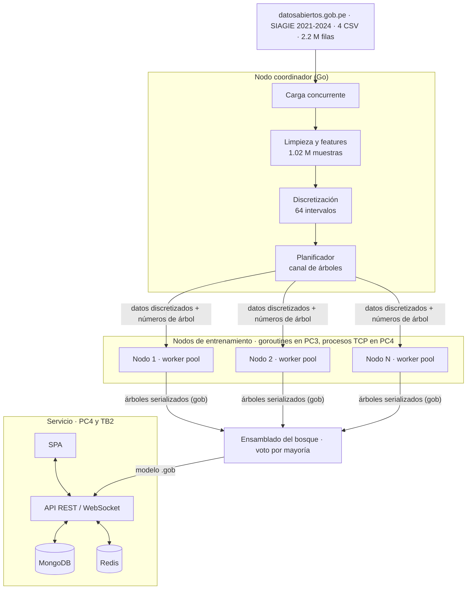
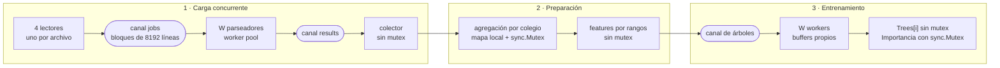

# Diseño del modelo de ML distribuido · EduForest (PC3)

## 1. Algoritmo: Random Forest

Un Random Forest es un conjunto de árboles de decisión que votan. Cada árbol se entrena así:

1. **Bootstrap:** se sortean, con reemplazo, tantas filas como tiene el set de entrenamiento (773,206 muestras de 2021-2023). Como las clases están desbalanceadas (94% de riesgo bajo), el sorteo es **balanceado**: primero se elige la clase, con probabilidad proporcional a `frecuencia^(1 - balance)`, y luego una fila de esa clase. Con `balance = 0.5` las clases raras pesan más sin llegar a igualarse (ver `results/balance_experimento.txt`).
2. **Crecimiento CART:** en cada nodo se prueban √15 ≈ 3 features al azar y se elige el corte que más reduce el **índice de Gini**. El árbol crece hasta profundidad 14 o hasta que un nodo tenga menos de 100 filas o sea puro.
3. **Histogramas:** con 800 mil filas, ordenar los valores en cada nodo es demasiado lento. Cada feature se discretiza **una sola vez** en hasta 64 intervalos por cuantiles, y en cada nodo solo se cuenta cuántas filas de cada clase caen en cada intervalo. Es la misma técnica que usan LightGBM y XGBoost.

La predicción es el **voto por mayoría** de los 100 árboles. La importancia de cada feature es la reducción de Gini que aportó, sumada en todos los árboles.

## 2. Por qué se puede distribuir

Los árboles son **independientes entre sí**: para construir el árbol 37 no hace falta saber nada de los otros 99. Solo comparten datos de lectura (las muestras discretizadas y las etiquetas). Eso hace del entrenamiento un problema *embarrassingly parallel*: la **unidad de trabajo es el árbol** y no hay que sincronizar nada mientras se construye.

Además, **cada árbol tiene su propia semilla** (`semilla + número_de_árbol × 7919`). El bosque que sale es idéntico sin importar cuántos workers o nodos lo construyan ni en qué orden terminen, y hay un test que lo comprueba (`TestConcurrentEqualsSequential`).

## 3. Arquitectura

| Componente | Responsabilidad | Estado |
|---|---|---|
| Coordinador | Carga, limpieza, discretización, reparto de árboles y ensamblado del bosque | PC3 (implementado) |
| Nodos de entrenamiento | Construir los árboles que les toquen con su propio worker pool | PC3: goroutines en una máquina · PC4: procesos en contenedores Docker conectados por TCP |
| API | Servir predicciones del modelo `.gob` en menos de 100 ms | PC4 |
| MongoDB / Redis | Guardar predicciones y cachear consultas frecuentes | PC4 |
| SPA | Mostrar el riesgo por colegio a un usuario no técnico | TB2 |

## 4. Protocolo previsto para la PC4

1. El coordinador abre una conexión TCP con cada nodo y le envía **una sola vez** la configuración (profundidad, balance, semilla) y los datos discretizados: 773,206 filas × 15 features en `uint8` son unos 11.6 MB, más las etiquetas.
2. Luego reparte **números de árbol** por un canal, igual que hoy entre goroutines. Cada nodo los recibe, construye el árbol con la semilla de ese número y devuelve el árbol serializado con `encoding/gob`.
3. Si un nodo se cae, el coordinador vuelve a encolar los números de árbol que tenía pendientes. Como cada árbol depende solo de su número, otro nodo lo reconstruye igual.
4. Al recibir los 100 árboles, el coordinador arma el bosque, normaliza la importancia y guarda `models/<objetivo>.gob` para la API.

Enviar los datos una sola vez y después solo números de árbol mantiene el tráfico de red mínimo: lo que viaja en cada tarea son unos bytes de ida y el árbol (~45 KB) de vuelta.

## 5. Concurrencia dentro del coordinador (PC3)

| Patrón de Go | Dónde se usa | Archivo |
|---|---|---|
| Pipeline con canales | lectores → parseadores → colector | `internal/dataset/loader.go` |
| Worker pool | parseo de bloques y construcción de árboles | `loader.go`, `internal/forest/train.go` |
| Fan-out / fan-in | 4 lectores alimentan un canal; W workers alimentan otro | `loader.go` |
| `sync.WaitGroup` | cerrar cada canal cuando terminan sus productores | `loader.go`, `train.go`, `prepare.go` |
| `sync.Mutex` | fusionar mapas de agregación y acumular la importancia | `prepare.go`, `train.go` |
| Semáforo (canal con buffer) | limitar las goroutines que discretizan features | `internal/forest/binning.go` |
| Particionado sin bloqueo | cada goroutine escribe solo en su rango o posición | `prepare.go`, `forest.go`, `train.go` |
| Reutilización de buffers | cada worker reutiliza sus buffers en todos sus árboles (menos GC) | `train.go` |
